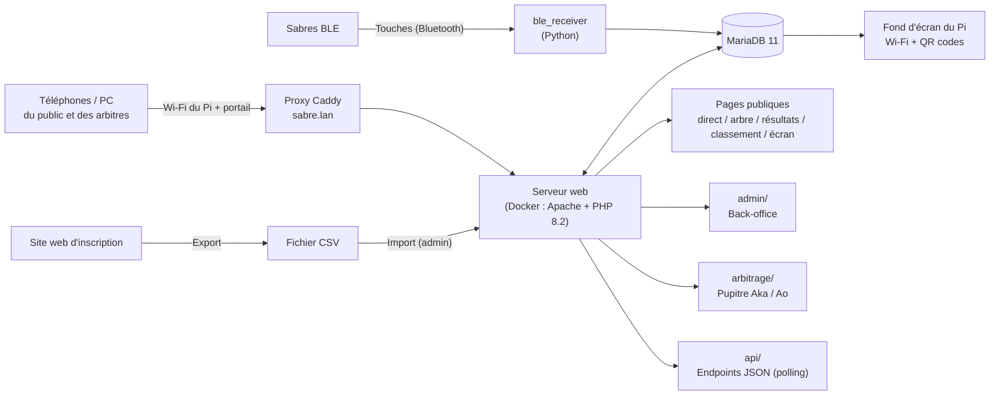
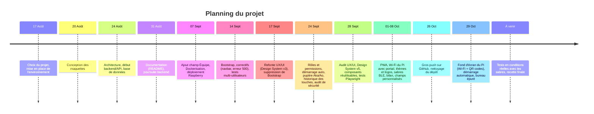

# Cahier des charges — Webapp Arbitrage Sabre Laser

**Projet :** 2026-27_I.DA-P3B_LuTo
**Équipe :** Tom & Lucas
**Établissement :** CFPT-AWEB-PH
**Dernière mise à jour :** 29.10.2026
**Documents liés :** [Journal de bord](https://github.com/CFPT-AWEB-PH/2026-27_I.DA-P3B_LuTo/blob/main/journalDeBord.md) · [README technique](https://github.com/CFPT-AWEB-PH/2026-27_I.DA-P3B_LuTo/blob/main/webapp_arbitrage_avec_touche/README.md) · [Audit de sécurité](https://github.com/CFPT-AWEB-PH/2026-27_I.DA-P3B_LuTo/blob/main/webapp_arbitrage_avec_touche/SECURITE.md) · [Design system](https://github.com/CFPT-AWEB-PH/2026-27_I.DA-P3B_LuTo/blob/main/webapp_arbitrage_avec_touche/DESIGN.md)

---

## Sommaire

1. [Contexte et présentation](#1-contexte-et-présentation)
2. [Objectifs du projet](#2-objectifs-du-projet)
3. [Utilisateurs cibles](#3-utilisateurs-cibles)
4. [Besoins fonctionnels](#4-besoins-fonctionnels)
5. [Besoins non fonctionnels](#5-besoins-non-fonctionnels)
6. [Contraintes techniques](#6-contraintes-techniques)
7. [Architecture générale](#7-architecture-générale)
8. [Modèle de données](#8-modèle-de-données)
9. [Planning](#9-planning)
10. [Livrables](#10-livrables)
11. [Répartition des rôles](#11-répartition-des-rôles)
12. [Risques identifiés](#12-risques-identifiés)
13. [Critères de réussite / recette](#13-critères-de-réussite--recette)

---

## 1. Contexte et présentation

Dans le cadre du module de projet, l'équipe (Tom & Lucas) développe une application web de **gestion et d'arbitrage de tournois de sabre laser**. L'application gère tout le cycle de vie d'un tournoi : inscription des participants, génération de l'arbre de tournoi, arbitrage des combats en direct, détection des touches par des sabres Bluetooth, affichage public des scores, classement final et bilan de fin de journée.

Le projet intègre l'atelier Raspberry Pi suivi en parallèle : l'application tourne de manière **autonome sur un Raspberry Pi** en salle, via Docker. Le Pi diffuse son propre **Wi-Fi isolé** (avec portail d'identification), reçoit les touches des sabres en **Bluetooth (BLE)** et affiche sur son écran les informations de connexion pour le public.

## 2. Objectifs du projet

- Permettre l'**inscription** des participants par import d'un fichier CSV, ou par inscription libre sur le site.
- Générer et afficher un **arbre de tournoi** (bracket) clair et lisible par le public.
- Fournir aux **arbitres** un pupitre simple pour donner les points en direct (3 arbitres par combat : 1 central + 2 coins).
- **Détecter automatiquement les touches** grâce à des sabres connectés en Bluetooth.
- Afficher en **continu** sur un écran de salle les combats en cours, à venir, et les scores.
- Donner à l'**administrateur** un contrôle complet sur le tournoi (paramètres, participants, combats, rôles, apparence, Wi-Fi) sans toucher au code.
- Rendre l'application **déployable facilement** (Docker) sur un Raspberry Pi, utilisable **sans internet** et installable sur téléphone (**PWA**).
- Garantir un bon niveau de **sécurité** (audit complet réalisé).

## 3. Utilisateurs cibles

| Profil | Besoins principaux |
|---|---|
| **Public / spectateurs** | Rejoindre le Wi-Fi du tournoi, consulter le direct, l'arbre, les résultats, le classement et l'écran de salle |
| **Joueurs** | S'inscrire, suivre leurs combats et leur classement |
| **Arbitres** | Donner les points en direct pour les combats qui leur sont assignés |
| **Organisateurs** | Rôles personnalisés avec seulement certaines permissions (ex. gérer les joueurs, signaler un retard) |
| **Administrateur** | Tous les droits : participants, combats, comptes, rôles, sabres, paramètres, apparence, Wi-Fi, bilan |

## 4. Besoins fonctionnels

### 4.1 Inscription & import des participants
- Import d'un fichier CSV des joueurs (pseudo, nom, prénom, sexe, date de naissance, poids, grade, équipe).
- Validation de l'import : taille et nombre de lignes limités, type de fichier vérifié, champs nettoyés, messages d'erreur clairs.
- Inscription libre sur le site (rôle « joueur » imposé), pouvant être fermée dans les paramètres.
- **Champs personnalisés** sur les fiches joueurs (licence, taille, main forte, contact d'urgence…), créés par l'organisateur.
- Export CSV des joueurs et de l'historique des combats (protégé contre l'injection de formules).

### 4.2 Gestion du tournoi (admin)
- Création, modification, suppression des combats, avec sélection multiple (démarrer, terminer, supprimer).
- **Génération automatique du tournoi** : choix des joueurs et des arbitres, planning (heure du premier combat, intervalle, durée).
- Appariement des joueurs selon des critères configurables (écart de poids, d'âge, de grade, même sexe).
- Arbre de tournoi (tour, position) mis à jour au fil des résultats.
- **Démarrage automatique** des combats à leur heure prévue, si les 3 arbitres sont libres et qu'aucun joueur n'est déjà en combat.
- Pause et reprise d'un combat ; clôture automatique à la fin du chrono.
- **Gestion des retards** : un retard signalé décale automatiquement l'heure de tous les combats à venir et s'affiche au public.
- Gestion des comptes utilisateurs, des grades et des **rôles dynamiques** (permissions cochées section par section).
- Paramètres du tournoi regroupés en sections (durée d'un combat, critères d'appariement, fréquences d'actualisation, inscriptions, démarrage auto…).
- **Bilan de fin de journée** prêt à imprimer (podium, classement, arbre, historique des combats avec points de chaque arbitre et touches, fiches joueurs).

### 4.3 Arbitrage
- Attribution de 3 arbitres par combat (1 central + 2 coins).
- **Pupitre Aka / Ao** : Aka (rouge, à gauche) et Ao (bleu, à droite), boutons +1, +2, +3, annulation du dernier point.
- Score officiel d'un joueur = **le total le plus bas parmi les 3 arbitres**.
- **Points de victoire** selon l'écart : 1 à 5 points = 1 pt, 6 à 15 = 2 pts, plus de 15 = 3 pts.
- Détermination du vainqueur à la fin du combat.
- Historique des touches sur la page du combat et dans l'espace d'arbitrage (compteur, doubles, frise, liste).

### 4.4 Sabres Bluetooth (touches)
- Enregistrement des sabres dans Admin › Sabres (adresse, joueur), avec détection des appareils alentour.
- Récepteur BLE sur le Raspberry (service Docker `ble_receiver`) : connexion simultanée aux sabres, détection des touches, règle de la **double touche** (fenêtre de 200 ms), reconnexion automatique.
- État du récepteur visible dans l'admin (actif, arrêté, en erreur).
- Annonce plein écran sur l'écran de salle à chaque touche.

### 4.5 Affichage public
- Page d'accueil « En direct » (combats en cours et à venir).
- Arbre de tournoi consultable par tous, avec légende.
- Page « Résultats » (le vainqueur ressort) et classement trié par points de victoire (ex æquo, médailles).
- Écran de salle : rotation automatique entre combats en cours, à venir et scores, actualisé en continu (polling).
- Indicateur unique « Connexion perdue » en cas de coupure réseau.

### 4.6 Authentification & comptes
- Connexion / déconnexion, page « Mon compte » (changement de mot de passe).
- Changement obligatoire du mot de passe par défaut ou réinitialisé.
- Droits d'accès vérifiés côté serveur sur chaque page, action et API, selon les permissions du rôle.

### 4.7 Apparence & application installable
- **Thèmes** (Basique sombre, Clair, Orange · blanc · bleu) et **thèmes personnalisés** (8 couleurs, aperçu en direct).
- **Logos** envoyés par l'organisateur, appliqués partout (barre, connexion, écran de salle, favicon, icône de l'app).
- **PWA** : application installable sur l'écran d'accueil, page « hors connexion », cache des ressources (jamais des scores).

### 4.8 Raspberry Pi : Wi-Fi et écran
- Point d'accès **Wi-Fi isolé** (pas d'internet, pas d'accès au réseau local ni au SSH) avec **portail identifiant + mot de passe**.
- Comptes Wi-Fi et nom du réseau gérés depuis Admin › Wi-Fi (appliqués sur le Pi en ~15 s).
- Site accessible par `http://sabre.lan` ou `10.42.0.1`, HTTPS facultatif avec une autorité de certification locale.
- **Fond d'écran du Pi** avec le nom du Wi-Fi, le mot de passe, l'accès choisi dans Admin › Wi-Fi et deux **QR codes** (rejoindre le Wi-Fi, ouvrir le site), mis à jour automatiquement.
- **Démarrage automatique** du site à l'allumage du Pi, bureau épuré avec un seul raccourci vers le site.

## 5. Besoins non fonctionnels

- **Performance** : actualisation en direct (scores, chrono, touches) fluide avec plusieurs écrans et clients connectés ; limites de débit sur les API (600 requêtes/min par IP, 240 appuis/min par arbitre).
- **Fiabilité** : erreurs jamais affichées au visiteur (référence d'erreur + journal serveur), réponses HTTP explicites (400/403/404) ; heure du serveur commune à PHP, MariaDB, récepteur BLE et affichage.
- **Compatibilité** : toutes les pages testées de 320 px (petit téléphone) à la TV 4K, portrait et paysage ; tous les navigateurs courants (Chrome, Safari, Firefox, Samsung Internet, Edge).
- **Utilisabilité** : design system documenté (`DESIGN.md`) ; une seule action principale par écran ; retours systématiques (toasts, boutons en chargement, confirmations, états vides) ; animations coupées si « réduire les animations » est activé.
- **Fonctionnement hors internet** : polices et ressources intégrées au projet.
- **Portabilité** : déploiement identique entre poste de développement et Raspberry Pi grâce à Docker.
- **Sécurité** (détail dans `SECURITE.md`) :
  - mots de passe hachés (bcrypt), 8 caractères minimum, mots de passe courants refusés ;
  - protection contre la force brute (5 échecs par identifiant, 20 par IP sur 15 min) ;
  - sessions sécurisées (HttpOnly, SameSite, expiration, révocation au changement de rôle ou de mot de passe) ;
  - CSRF sur tous les formulaires, plus aucune action par lien GET ;
  - en-têtes de sécurité (CSP avec nonce, anti-clickjacking, HSTS en HTTPS) ;
  - Apache refuse tout par défaut (`.env`, SQL, sauvegardes jamais servis) ; code en lecture seule dans le conteneur ;
  - protection contre l'escalade de privilèges entre rôles.
- **Maintenabilité** : composants PHP réutilisables (`includes/ui.php`), paramètres du tournoi en base (table `parametres`) modifiables sans toucher au code, migrations de base automatiques.

## 6. Contraintes techniques

| Contrainte | Détail |
|---|---|
| Langage backend | PHP 8.2 natif (pas de framework) |
| Base de données | MariaDB 11 |
| Frontend | HTML / CSS / JavaScript natifs, design system maison (Bootstrap abandonné), polices Barlow intégrées |
| Récepteur Bluetooth | Python 3.11 (bleak, PyMySQL) |
| Conteneurisation | Docker Compose : `web`, `db`, et en option `ble_receiver` (profil `ble`), `proxy` Caddy (profil `pi`), `tunnel` Cloudflare (profil `tunnel`, désactivé par défaut) |
| Hébergement cible | Raspberry Pi avec écran tactile 800×480, Wi-Fi intégré (point d'accès) et Bluetooth |
| Réseau | Wi-Fi du tournoi isolé, sans internet ; accès LAN facultatif |
| Échange de données initial | Fichier CSV exporté depuis un site d'inscription externe |

## 7. Architecture générale

## 8. Modèle de données

Base `sabre_arbitrage` (MariaDB) — tables principales :

| Domaine | Tables |
|---|---|
| Comptes et droits | `users`, `roles`, `role_permissions`, `limites_debit` |
| Joueurs | `joueurs`, `grades`, `champs_joueur`, `joueur_champs_valeurs` |
| Tournoi | `combats`, `combat_arbitres`, `points`, `points_live`, `manches_resultats`, `parametres` |
| Sabres BLE | `sabres`, `touchers`, `ble_scan_cache` |
| Apparence | `themes_perso`, `logos` |
| Wi-Fi | `wifi_comptes`, `wifi_etat` |

Le diagramme entité-relation est disponible dans le [journal de bord](https://github.com/CFPT-AWEB-PH/2026-27_I.DA-P3B_LuTo/blob/main/journalDeBord.md), le schéma SQL dans `sql/schema.sql` et les migrations dans `sql/`.

## 9. Planning

## 10. Livrables

- Code source de l'application (dépôt Git, dossier `webapp_arbitrage_avec_touche/`).
- Schéma de base de données (`sql/schema.sql`) et scripts de migration.
- Configuration Docker (`Dockerfile`, `docker-compose.yml`, dossier `docker/`).
- Scripts d'installation du Raspberry (`raspberry/` : Wi-Fi, portail, écran, raccourci).
- Récepteur Bluetooth (`ble_receiver/`).
- Documentation : README technique, `SECURITE.md`, `DESIGN.md`, journal de bord, cahier des charges.
- Tests : `tests/securite_test.py` (65 tests de sécurité), `tests/verif_fonctionnement.py`.
- Application déployée et fonctionnelle sur le Raspberry Pi.

## 11. Répartition des rôles

| Membre | Domaine principal |
|---|---|
| **Lucas** | Backend / API, CSS et design system (v4), système de points Aka/Ao, historique des touches, pages publiques, back-office admin, Admin › Wi-Fi |
| **Tom** | Maquettes, import CSV, base de données, Docker, rôles et permissions, page Combats et démarrage auto, refonte UX v3 et v5, déploiement et configuration du Raspberry (fond d'écran, démarrage auto), tests |

Les deux membres ont réalisé ensemble l'audit de sécurité et contribuent conjointement à la documentation (journal de bord, README).

## 12. Risques identifiés

| Risque | Impact | Mitigation |
|---|---|---|
| Interface non adaptée au Raspberry / mobile | Mauvaise expérience en salle | Design system maison, tests de 320 px à la 4K (résolu) |
| Erreurs lors de l'import CSV | Blocage de l'inscription | Validation stricte, limites de taille, messages clairs (erreur 500 résolue) |
| Retards dans le déroulement des combats | Décalage du planning | Signalement d'un retard qui décale automatiquement tous les combats à venir (résolu) |
| Accès concurrent de plusieurs utilisateurs | Incohérence des données affichées | Tests multi-utilisateurs, polling de l'API, limites de débit |
| Fuite de données ou prise de contrôle du compte admin | Résultats faussés, données personnelles exposées | Audit de sécurité complet, Apache « tout refusé par défaut », mot de passe par défaut à changer, tunnel désactivé par défaut |
| Connexion Bluetooth instable avec les sabres | Touches non comptées | Reconnexion automatique, un seul scan à la fois, état du récepteur visible dans l'admin, points des arbitres indépendants des touches |
| Public qui n'arrive pas à se connecter au Wi-Fi | Site inaccessible en salle | Portail compatible Android / iPhone / PC, QR codes et identifiants affichés sur l'écran du Pi |
| Tunnel Cloudflare actif sans le savoir | Site exposé sur internet | Profil Docker explicite (`--profile tunnel`), à arrêter si inutile |
| Dépôt Git privé / problème d'interface Git | Retard de déploiement ou de push | Connexion authentifiée depuis le Pi, push en ligne de commande (résolu) |

## 13. Critères de réussite / recette

- [x] Un fichier CSV de participants peut être importé sans erreur, champ « Équipe » inclus.
- [x] L'arbre de tournoi se génère et se met à jour automatiquement après chaque combat.
- [x] Un combat peut être arbitré de bout en bout par 3 arbitres avec calcul correct du score officiel et des points de victoire.
- [x] L'écran de salle actualise en continu les combats en cours / à venir et les scores.
- [x] L'interface reste utilisable et lisible en format téléphone comme en format ordinateur.
- [x] L'application se déploie via `docker compose up` (après avoir rempli `.env` à partir de `.env.example`).
- [x] Les retards sont répercutés automatiquement sur les combats suivants.
- [x] Les droits d'accès sont respectés pour chaque rôle (tests de sécurité réussis).
- [x] Le public peut rejoindre le Wi-Fi du Pi, s'identifier sur le portail et ouvrir le site.
- [x] À l'allumage du Pi, le site démarre seul et l'écran affiche le Wi-Fi, l'identifiant et les QR codes.
- [ ] Les touches des sabres Bluetooth sont détectées et affichées en direct pendant un vrai combat.
- [ ] Recette finale d'un tournoi complet en conditions réelles.
