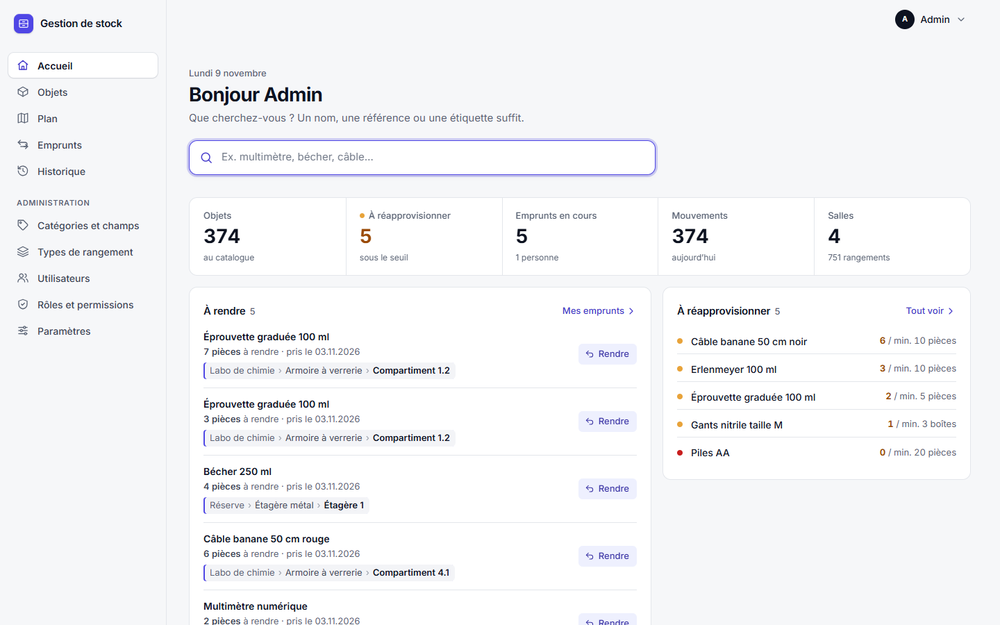
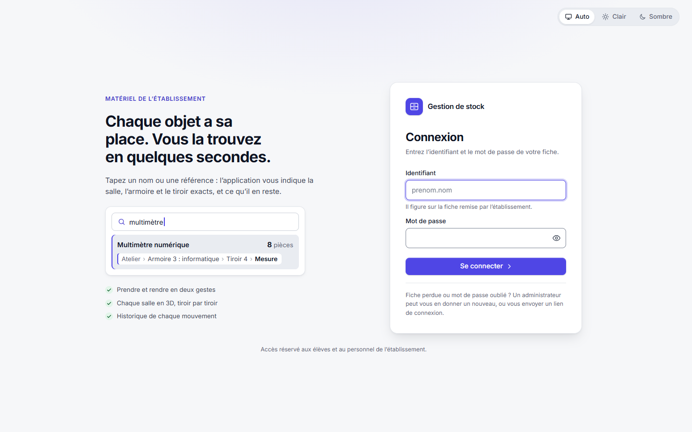
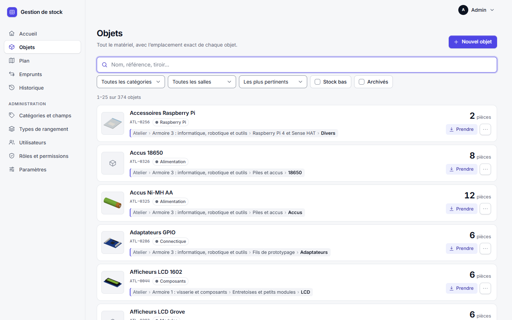
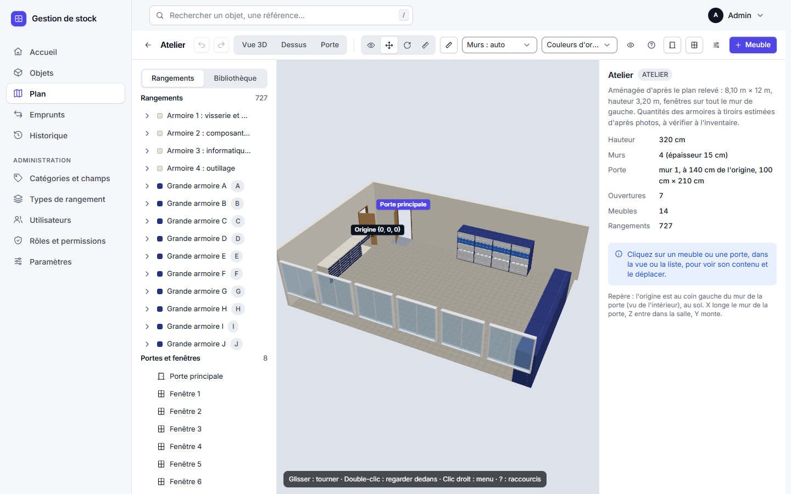
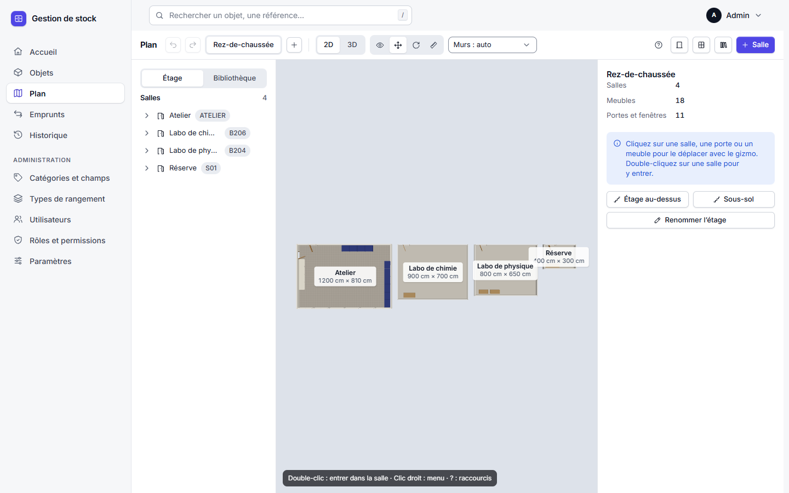
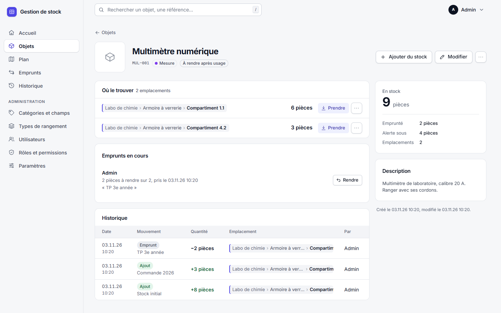
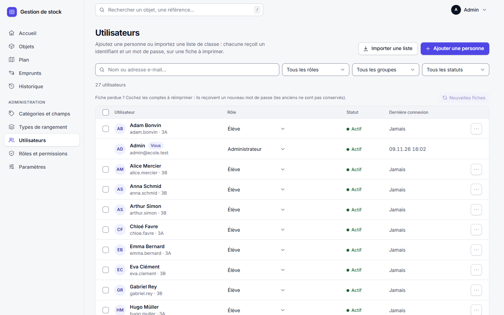
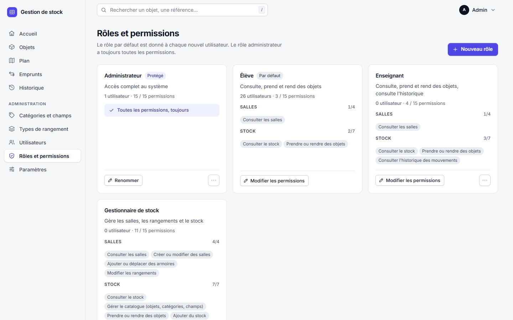
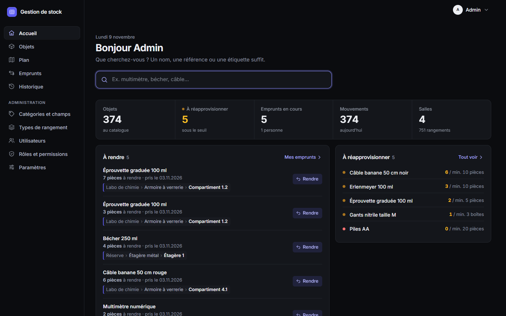
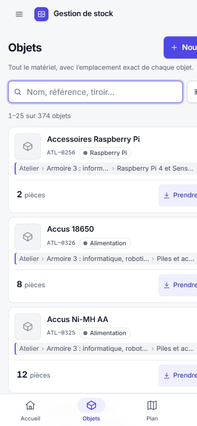

# 🗄️ Gestion de stock en 3D

Application web pour retrouver **chaque objet du matériel de l'école** : on tape un nom ou une référence, et
l'application indique la salle, l'armoire, le tiroir et la boîte exacts, **montrés en 3D**, avec la quantité
restante. On emprunte et on rend en deux gestes, et chaque mouvement est tracé. Elle tourne sur un
**Raspberry Pi** de l'atelier, qui sert aussi de poste partagé verrouillé.

**Projet CFPT — 2026-27, classe I.DA-P3B · Réalisation : Tom · 02.11.2026 → 09.11.2026**



---

## 🚀 Installation rapide (poste de développement)

Prérequis : [Docker](https://docs.docker.com/get-docker/) installé et démarré (sous Windows, commandes dans **Git Bash**).

```bash
git clone https://github.com/CFPT-AWEB-PH/2026-27_I.DA-P3B_LuTo.git
cd 2026-27_I.DA-P3B_LuTo/gestion-stock
cp .env.example .env          # puis remplir DB_PASSWORD, DB_ROOT_PASSWORD, BOOTSTRAP_ADMIN_EMAIL
                              # et mettre APP_URL=http://localhost
docker compose up -d --build
docker compose run --rm php php bin/migrate.php
docker compose exec php php bin/create-admin.php prenom.nom@exemple.ch
docker compose exec php php bin/login-link.php prenom.nom@exemple.ch   # lien de connexion à usage unique
```

Le site s'ouvre sur **http://localhost**. Pour avoir des données de démonstration (salle « Atelier », armoires,
tiroirs et objets) : `docker compose exec php php bin/seed-atelier.php`.

Installation sur le Raspberry Pi (déploiement par version, sauvegardes, HTTPS, poste verrouillé) :
voir le **[guide d'exploitation](docs/EXPLOITATION.md)**.

---

## ✨ Fonctionnalités

| Pour qui | Ce que l'application permet |
|----------|-----------------------------|
| **Élèves** | Chercher un objet (nom, référence, étiquette, emplacement), le voir en 3D dans son tiroir, le prendre et le rendre, suivre ses emprunts |
| **Enseignants** | Tout ce qui précède, plus l'historique des mouvements et les objets à réapprovisionner |
| **Gestionnaires de stock** | Catalogue, catégories et champs personnalisés, ajout et correction de stock, déplacements, photos |
| **Administrateurs** | Plan du bâtiment et éditeur 3D des salles, comptes (import Excel, fiches à imprimer), rôles et permissions, paramètres |

- **Vue 3D** des salles (Three.js) : armoires, tiroirs qui s'ouvrent, bacs étiquetés, objets dessinés à leur place
  (89 modèles), objets empruntés en gris, « regarder dedans », couleurs de remplissage.
- **Plan du bâtiment** : étages, salles déplaçables au gizmo, portes et fenêtres, modèles de rangement réutilisables,
  annuler / rétablir, copier / couper / coller.
- **Recherche** plein texte côté serveur (5000 objets en moins de 0,3 s sur le Pi), suggestions au clavier (`/`, `Ctrl+K`).
- **Stock fiable** : opérations atomiques (20 prises simultanées sur un stock de 6 : exactement 6 acceptées),
  journal des mouvements immuable, retour seulement à l'emplacement d'origine.
- **Comptes** : import d'une liste de classe Excel, identifiant et mot de passe générés, fiches à découper.
- **PWA** installable, thème clair / sombre au choix, mobile, clavier, accessibilité (contrastes AA).
- **Raspberry Pi** : HTTPS, sauvegardes quotidiennes, mises à jour nocturnes, poste partagé verrouillé sur l'application.

**Technologies :** PHP 8.3 (FPM) · MariaDB 11.4 · Caddy 2.10 · JavaScript sans framework · Three.js 0.170 ·
Docker Compose · Raspberry Pi 4 (Debian 13, labwc).

---

## 🖼️ Aperçu

| | |
|---|---|
|  Connexion |  Catalogue |
|  Atelier en 3D |  Plan du bâtiment |
|  Fiche d'un objet |  Utilisateurs |
|  Rôles et permissions |  Thème sombre |

<p align="center"></p>

Fond d'écran du poste de l'atelier : [scripts/poste/fond-ecran.png](scripts/poste/fond-ecran.png).

*Captures prises sur une copie locale avec des données fictives.*

---

## 📁 Organisation du dossier

```
gestion-stock/
├── frontend/            Interface : HTML, CSS, JavaScript (modules), PWA, Three.js local, police Inter
├── backend/             API PHP 8.3 : routeur, contrôleurs, services, authentification
│   ├── bin/             Migrations, administrateur initial, liens de connexion, données de l'atelier
│   └── tests/           Tests d'intégration (auth, salles, stock, plan, PWA, sécurité, import…)
├── database/migrations/ Schéma SQL versionné (0001 à 0007)
├── docker/              Images et configuration : Caddy, PHP-FPM, MariaDB, sauvegardes
├── scripts/             Déploiement, retour arrière, sauvegarde et restauration, tests sur le Pi
│   └── poste/           Poste partagé du Pi : kiosque, fond d'écran, pare-feu, mises à jour, IP fixe
├── docker-compose.yml
└── docs/
    ├── cahier-des-charges.md
    ├── journal-de-bord.md     Déroulement du projet jour par jour
    ├── ARCHITECTURE.md        Choix techniques, repère spatial, modèle de données, risques
    ├── EXPLOITATION.md        Raspberry Pi : déploiement, sauvegardes, HTTPS, poste verrouillé
    ├── SECURITE.md            Modèle de menace, audit, risques restants
    ├── DESIGN.md              Design system et refontes de l'interface
    ├── JOURNAL.md             Journal technique détaillé, phase par phase
    └── images/                Captures d'écran
```

---

## 🧪 Tests

Sur le serveur (Raspberry Pi), toutes les suites d'intégration :

```bash
bash ~/gestion_stock/current/scripts/run-tests.sh <email-administrateur>
```

489 vérifications au total : authentification et sessions, escalades de privilèges, salles et validation spatiale,
stock et concurrence, recherche sur 5000 objets, plan et modèles, PWA, import de comptes, apparence 3D.

---

## 📚 Documentation

- **[Cahier des charges](docs/cahier-des-charges.md)** — besoins, contraintes, planning, recette
- **[Journal de bord](docs/journal-de-bord.md)** — ce qui a été fait le 02.11, le 05.11 et le 09.11
- **[Architecture](docs/ARCHITECTURE.md)** · **[Exploitation](docs/EXPLOITATION.md)** · **[Sécurité](docs/SECURITE.md)** · **[Design](docs/DESIGN.md)**

---

## 🔐 Sécurité

Refus par défaut sur toutes les routes, permissions vérifiées côté serveur, protection contre les escalades de
privilèges, sessions hachées en base, CSRF, mots de passe jamais conservés en clair, CSP stricte, conteneurs en
lecture seule. Sur le Pi : HTTPS, pare-feu, SSH par clé, poste partagé sans droits ni mots de passe enregistrés.
Détail : [docs/SECURITE.md](docs/SECURITE.md).
