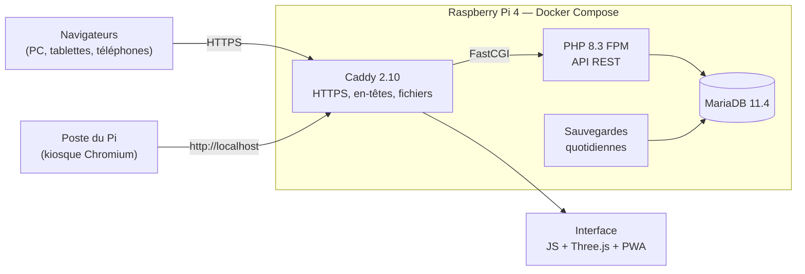
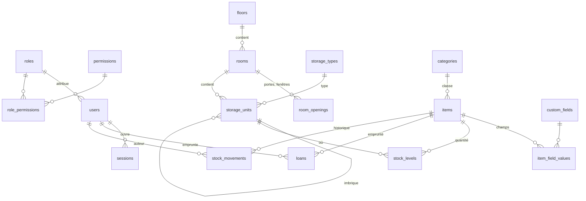

# Cahier des charges — Gestion de stock en 3D

**Projet :** 2026-27_I.DA-P3B_LuTo — dossier `gestion-stock/`
**Réalisation :** Tom
**Établissement :** CFPT
**Période :** 02.11.2026 → 09.11.2026 (trois journées : 02.11, 05.11, 09.11)
**Dernière mise à jour :** 09.11.2026
**Documents liés :** [Journal de bord](journal-de-bord.md) · [Architecture](ARCHITECTURE.md) · [Exploitation](EXPLOITATION.md) · [Sécurité](SECURITE.md) · [Design](DESIGN.md)

---

## Sommaire

1. [Contexte et présentation](#1-contexte-et-présentation)
2. [Objectifs du projet](#2-objectifs-du-projet)
3. [Utilisateurs cibles](#3-utilisateurs-cibles)
4. [Besoins fonctionnels](#4-besoins-fonctionnels)
5. [Besoins non fonctionnels](#5-besoins-non-fonctionnels)
6. [Contraintes techniques](#6-contraintes-techniques)
7. [Architecture générale](#7-architecture-générale)
8. [Modèle de données](#8-modèle-de-données)
9. [Planning](#9-planning)
10. [Livrables](#10-livrables)
11. [Risques identifiés](#11-risques-identifiés)
12. [Critères de réussite / recette](#12-critères-de-réussite--recette)

---

## 1. Contexte et présentation

Le matériel de l'atelier et des laboratoires (composants, visserie, outillage, verrerie, appareils de mesure) est
réparti dans des dizaines d'armoires, de tiroirs, de bacs et de boîtes. Retrouver un objet, savoir s'il en reste et
qui l'a emprunté demande aujourd'hui de fouiller ou de demander.

Le projet consiste à réaliser une **application web de gestion de stock** qui modélise les salles **en 3D** avec
leurs rangements imbriqués, et qui suit chaque objet : où il est, combien il en reste, qui l'a pris. Elle est
hébergée sur un **Raspberry Pi** installé dans l'atelier, qui sert aussi de **poste partagé** en libre accès.

## 2. Objectifs du projet

- **Retrouver un objet en quelques secondes** : une recherche (nom, référence, étiquette, emplacement) donne la salle,
  l'armoire, le tiroir et la boîte exacts, et les montre dans la vue 3D.
- **Modéliser les salles en 3D** à l'échelle : murs, portes, fenêtres, meubles et rangements imbriqués sans limite de profondeur.
- **Tracer le stock** : prises, retours, consommations, réapprovisionnements, corrections et déplacements, avec qui, quand et où.
- **Gérer les accès** : comptes, rôles et permissions fines ; comptes d'élèves créés depuis une liste de classe.
- **Rendre l'outil agréable** sur ordinateur, tablette et téléphone, installable (PWA), en clair ou en sombre.
- **Exploiter sereinement** le Raspberry Pi : déploiement sans coupure, sauvegardes, mises à jour, sécurité, poste verrouillé.

## 3. Utilisateurs cibles

| Profil | Besoins principaux |
|---|---|
| **Élève** (rôle par défaut) | Chercher, voir en 3D, prendre et rendre un objet, consulter ses emprunts |
| **Enseignant** | Comme l'élève, plus l'historique et le suivi des objets à réapprovisionner |
| **Gestionnaire de stock** | Catalogue, catégories, champs personnalisés, stock, photos, rangements internes |
| **Administrateur** (protégé) | Tous les droits : salles et plan, comptes, rôles, paramètres |
| **Poste partagé** (écran de l'atelier) | Utiliser l'application sans rien pouvoir faire d'autre sur la machine |

## 4. Besoins fonctionnels

### 4.1 Comptes, connexion et permissions
- Connexion par **identifiant et mot de passe** (fiche remise à chaque personne), ou par **lien à usage unique** généré en SSH.
- Import d'une **liste de classe** (.xls, .xlsx, .csv) : identifiant unique et mot de passe générés, **fiches à découper** (8 par page A4).
- Ajout d'une personne à la fois ; nouvelles fiches pour une sélection (l'ancien mot de passe est invalidé).
- Rôles personnalisables avec **15 permissions** (salles, meubles, rangements, stock, utilisateurs, rôles, paramètres…).
- Protections : rôle administrateur non modifiable, dernier administrateur impossible à supprimer, aucune escalade de privilèges.
- Connexion Google (OpenID Connect) : **prévue**, reportée (nécessite un nom de domaine).

### 4.2 Salles et rangements en 3D
- Salle : contour rectangulaire ou libre, hauteur, porte de référence (origine du repère), fenêtres et portes.
- Rangements imbriqués : armoire › étagère › tiroir › boîte › compartiment… avec types fournis et personnalisés.
- **Validation spatiale côté serveur** : un rangement ne déborde pas de son parent et n'en chevauche pas un autre.
- Éditeur 3D : sélection, gizmo (déplacer, pivoter, redimensionner) avec aimantation, cotes, tiroirs qui s'ouvrent,
  « regarder dedans », génération d'intérieurs (tiroirs, grilles de bacs), modèles réutilisables.
- **Plan du bâtiment** : étages, salles placées et déplaçables, entrée dans une salle par double-clic.
- Raccourcis clavier : annuler / rétablir, copier, couper, coller, dupliquer, supprimer, modes du gizmo.

### 4.3 Stock
- Objets : référence unique, catégorie, champs personnalisés, unité, stock minimal, consommable ou non, photo.
- Stock **par emplacement** ; opérations : prendre, rendre (à l'emplacement d'origine), consommer, ajouter, corriger (motif), déplacer.
- **Historique immuable** de chaque mouvement, filtrable (utilisateur, salle, type, période).
- Objets dessinés **en 3D dans leur rangement**, empruntés en gris ; couleurs de remplissage (vide, partiel, plein).

### 4.4 Recherche et accueil
- Recherche plein texte : nom, référence, description, catégorie, champs, chemin complet, étiquettes ; sans accents.
- Suggestions instantanées, navigation au clavier, raccourcis `/` et `Ctrl+K`.
- Tableau de bord : objets, à réapprovisionner, emprunts en cours, mouvements du jour, salles.

### 4.5 Ergonomie
- Menu contextuel (clic droit, appui long, touche Menu) sur salles, objets, rangements et dans la 3D.
- Mobile (375 px sans défilement horizontal), PWA installable, thème clair / sombre au choix.

### 4.6 Poste partagé (Raspberry Pi)
- L'écran n'affiche **que l'application**, en plein écran, sur un fond d'écran dédié.
- Personne ne reste connecté : fenêtre fermée ou 10 minutes d'inactivité → déconnexion.
- Aucun mot de passe enregistré par le navigateur, aucun autre site accessible.

## 5. Besoins non fonctionnels

| Thème | Exigence |
|---|---|
| **Performance** | Recherche < 0,3 s sur 5000 objets sur le Pi ; rendu 3D à la demande |
| **Fiabilité** | Opérations de stock atomiques, stock jamais négatif, même sous accès simultanés |
| **Sécurité** | Refus par défaut, permissions côté serveur, CSRF, CSP stricte, mots de passe hachés (bcrypt), HTTPS |
| **Accessibilité** | Contrastes WCAG AA, navigation complète au clavier, cibles tactiles de 40 à 44 px |
| **Exploitation** | Déploiement par version avec retour arrière, sauvegardes quotidiennes testées, mises à jour automatiques |
| **Données personnelles** | Seuls nom, prénom et groupe sont conservés à l'import ; aucune liste de classe dans le dépôt |

## 6. Contraintes techniques

- **Matériel** : Raspberry Pi 4 (2 Go de RAM, carte SD de 28 Go), Debian 13 arm64.
- **Réseau de l'école** : adresses privées (10.5.35.0/26), pas de nom de domaine → HTTPS par une autorité interne
  (Let's Encrypt ne certifie pas une adresse IP privée).
- **Pas de framework** côté interface (modules JavaScript natifs) ; Three.js servi localement (pas de CDN, CSP stricte).
- **Tout dans Docker** : aucune installation de PHP ou de MariaDB sur le Pi ni sur le poste de développement.
- Fonctionnement **sans Internet** une fois installé.

## 7. Architecture générale

Détail : [ARCHITECTURE.md](ARCHITECTURE.md).

## 8. Modèle de données

Autres tables : `app_settings`, `audit_log`, `allowlist`, `login_tokens`, `rate_limits`, `storage_templates`.
Schéma complet : `database/migrations/`.

## 9. Planning

| Journée | Objectif | Résultat |
|---|---|---|
| **02.11.2026** | Audit du Pi, socle Docker, authentification, salles en 3D, stock et recherche | Phases 1 à 5 livrées et déployées (247 vérifications serveur) |
| **05.11.2026** | Refonte de l'interface, PWA, objets en 3D, plan du bâtiment, comptes par import, audit de sécurité | Phase 6, plan, import Excel, salle Atelier, audit corrigé et déployé |
| **09.11.2026** | Finitions, atelier réel, administration, poste partagé, HTTPS, IP fixe, documentation | Application finalisée, Pi verrouillé et sécurisé, dossier publié |

Détail jour par jour : [journal de bord](journal-de-bord.md).

## 10. Livrables

- Code source complet (`frontend/`, `backend/`, `database/`, `docker/`, `scripts/`).
- Application déployée sur le Raspberry Pi de l'atelier (HTTPS, adresse fixe).
- Poste partagé verrouillé (scripts `scripts/poste/`) avec son fond d'écran.
- Tests d'intégration automatisés (`backend/tests/`, `scripts/run-tests.sh`).
- Documentation : README, cahier des charges, journal de bord, architecture, exploitation, sécurité, design.

## 11. Risques identifiés

| Risque | Mesure |
|---|---|
| Carte SD qui lâche | Sauvegardes quotidiennes et hebdomadaires, test de restauration ; copie régulière hors du Pi à faire |
| Adresse IP qui change (DHCP) | IP fixe 10.5.35.30 ; réservation à demander au service informatique |
| Avertissement HTTPS (autorité interne) | Certificat racine à installer une fois par appareil, ou par GPO |
| Poste partagé détourné | Compte sans droits, session kiosque, pare-feu, polkit, déconnexion automatique |
| Accès concurrents au stock | Verrous et mises à jour conditionnelles, testé à 20 prises simultanées |
| Quantités de l'atelier estimées d'après photos | Signalées sur chaque objet ; inventaire réel à faire |

## 12. Critères de réussite / recette

- [x] Un élève trouve un objet par son nom et le voit dans son tiroir en 3D.
- [x] Prendre puis rendre un objet met à jour le stock et l'historique ; impossible de prendre plus que le stock.
- [x] Un élève ne peut ni modifier une salle, ni changer un rôle, ni accéder à l'administration (refusé côté serveur).
- [x] Les comptes d'une classe se créent depuis le fichier Excel et les fiches s'impriment.
- [x] Le site est servi en HTTPS ; le poste de l'atelier n'affiche que l'application.
- [x] Toutes les suites de tests passent sur une base neuve.
- [ ] Connexion Google (reportée : nom de domaine nécessaire).
- [ ] Inventaire réel de l'atelier (quantités).
