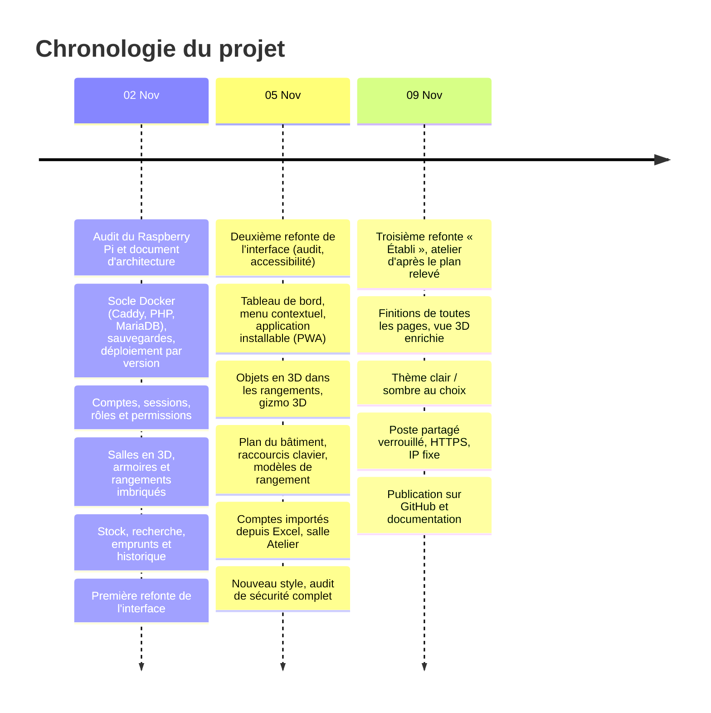
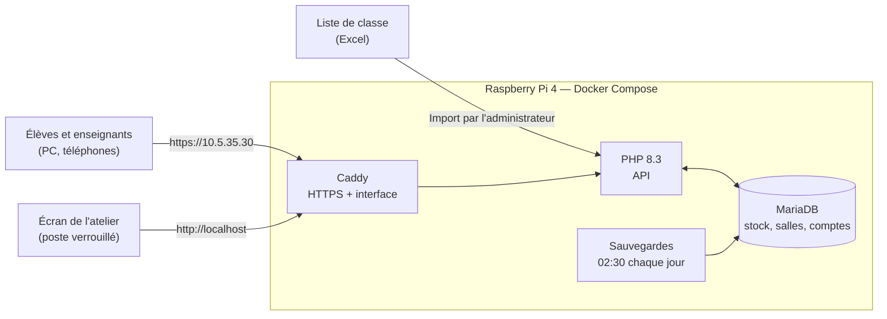

# Journal de bord — Projet Gestion de stock en 3D

**Projet :** Application web de gestion du matériel de l'école, avec les salles et les rangements en 3D
**Réalisation :** Tom (développement assisté par Claude, IA d'Anthropic, dans Claude Code)
**Infrastructure cible :** Raspberry Pi 4 de l'atelier (Docker : Caddy + PHP-FPM + MariaDB)
**Journal technique détaillé, phase par phase :** [JOURNAL.md](JOURNAL.md)

---

## 1. Chronologie du projet

---

## 2. Architecture générale du système

---

## 3. Journal détaillé

### 02.11 — Du Raspberry Pi vierge à une application complète

**Objectif :** poser toutes les fondations et livrer les fonctions principales.

**Audit et préparation (phase 1)**
- Poste de développement : Git, Node, Docker ; Raspberry Pi 4 (2 Go, Debian 13 arm64, 21 Go libres), accès SSH par clé.
- Document d'architecture : choix techniques, repère spatial (l'origine est la porte de la salle), modèle de données, risques.

**Socle technique (phase 2)**
- Docker Compose : Caddy 2.10, PHP 8.3 FPM, MariaDB 11.4 et un service de sauvegarde, tous avec contrôle de santé ;
  la base est sur un réseau interne sans accès extérieur.
- Migrations SQL versionnées, sauvegardes quotidiennes avec rotation, restauration testée.
- Déploiement par version : la nouvelle version n'est activée que si tout est sain ; retour arrière en une commande.

**Comptes et permissions (phase 3)**
- 15 permissions, 4 rôles (Administrateur protégé, Gestionnaire de stock, Enseignant, Élève par défaut).
- Sessions en base (seule l'empreinte du jeton est stockée), CSRF, limitation des tentatives, journal d'audit.
- Connexion par lien à usage unique ; la connexion Google est reportée (pas de nom de domaine).

**Salles en 3D (phase 4)**
- Salles (contour libre), portes et fenêtres, 8 types de rangement, rangements imbriqués sans limite.
- Validation spatiale côté serveur : pas de débordement ni de chevauchement, même avec deux écritures simultanées.
- Éditeur 3D avec Three.js : murs découpés autour des ouvertures, tiroirs qui s'ouvrent, déplacement à la souris.

**Stock et recherche (phase 5)**
- Catalogue, champs personnalisés, stock par emplacement, emprunts, journal des mouvements immuable.
- Opérations atomiques : **20 prises simultanées sur un stock de 6 → exactement 6 acceptées**.
- Recherche plein texte : **5000 objets en 65 à 265 ms** sur le Pi.
- Première refonte de l'interface (design system).

**Tests :** 247 vérifications serveur, 0 échec.
**Problème rencontré :** la limitation des connexions comptait aussi les connexions réussies et bloquait des comptes
légitimes → elle ne compte plus que les échecs.

---

### 05.11 — Interface, 3D, plan du bâtiment et sécurité

**Deuxième refonte de l'interface** (début de journée)
- Audit écran par écran à 1440, 768 et 375 px, en clair et en sombre.
- Corrigés : objets tous affichés « Archivé » au catalogue, « null » écrit dans l'historique, contrastes insuffisants.
- Revue selon les recommandations d'ergonomie d'Apple (Human Interface Guidelines).

**Tableau de bord, menu contextuel, PWA (phase 6)**
- Chiffres clés et derniers mouvements selon les permissions ; menu au clic droit ou à l'appui long partout.
- Application installable : manifeste, icônes, service worker, proposition de mise à jour.
- **Bug important trouvé :** l'éditeur 3D restait bloqué sur « Chargement… » pour tous les élèves depuis la phase 4
  (invisible pour les tests d'API) → corrigé, et depuis on teste toujours aussi avec un profil Élève.
- Le Pi a changé d'adresse (DHCP) : identifié par l'empreinte de sa clé SSH (un autre Pi du réseau porte le même nom).

**La 3D prend vie**
- Objets dessinés dans leurs tiroirs et bacs (89 modèles d'après 29 photos de l'atelier), à l'échelle.
- Gizmo 3D (déplacer W, pivoter E, redimensionner R) avec aimantation et refus expliqué en direct.
- Plan du bâtiment : étages, salles déplaçables, portes au gizmo, modèles de rangement réutilisables, Ctrl+Z / C / X / V.

**Comptes et atelier réel**
- Import d'une liste de classe Excel lue dans le navigateur (seuls nom, prénom et groupe partent au serveur),
  identifiants et mots de passe générés, fiches à découper. Le mot de passe n'est jamais conservé en clair.
- Salle « Atelier » créée avec ses armoires, ses 23 tiroirs et ses objets d'après les photos.
- Nouveau style (police Inter hébergée localement, accent indigo).

**Audit de sécurité**
- Test écrit d'abord sur l'ancien code : **47 échecs**, dont des escalades de privilèges (un gestionnaire pouvait
  se donner le rôle administrateur).
- Corrigé : garde contre les escalades, refus par défaut sur toutes les routes, quotas, conteneurs en lecture seule.
- Règle ajoutée : un objet emprunté ne peut être rendu qu'à son emplacement d'origine.

---

### 09.11 — Finitions, atelier réel, poste partagé et HTTPS

**Interface**
- Troisième refonte « Établi » (design system, parcours, mouvement), puis passe de finition page par page :
  accueil, catalogue, plan, éditeur, catégories, types de rangement, utilisateurs, rôles, paramètres.
- Page de connexion retravaillée ; **thème clair / sombre au choix** (connexion et menu du compte).
- Vue 3D : objets empruntés en gris à leur place, menu sur chaque objet, porte-étiquettes, « regarder dedans ».

**Atelier d'après le plan relevé**
- Salle de 8,10 m × 12 m, armoires à tiroirs, grandes armoires A à J avec étagères et boîtes, fenêtres.
- Réaménagement par script, testé sur une copie de la base : stock total identique avant et après.

**Le Raspberry Pi devient un poste partagé**
- Fond d'écran aux couleurs de l'application.
- Compte `poste` **sans aucun droit** ouvert automatiquement : l'écran n'affiche que l'application en plein écran.
- Navigateur neuf à chaque ouverture, **déconnexion après 10 minutes d'inactivité**, aucun mot de passe enregistré,
  aucun autre site accessible.
- Mise à jour du système chaque nuit à 3 h 30.

**Sécurité du serveur**
- Pare-feu (seuls le site et SSH depuis le réseau local), SSH par clé uniquement, services inutiles coupés.
- **HTTPS** sur l'adresse IP : Let's Encrypt est impossible sans nom de domaine, donc certificat de l'autorité interne
  de Caddy ; le certificat racine se télécharge sur `http://10.5.35.30/certificat.crt`.
- **Problème rencontré :** sans SNI (cas de toute adresse IP) et derrière Docker, Caddy ne trouvait pas le certificat
  → bloc HTTPS dédié avec `tls internal` et `default_sni`, vérifié avant le déploiement.

**Adresse fixe**
- Essai de 10.5.35.176 : hors du réseau de la prise (10.5.35.0/26) → le script revient tout seul à l'ancienne
  adresse après 60 s, sans rien casser.
- **IP fixe 10.5.35.30** : le site, le certificat et le pare-feu ont suivi automatiquement.

**Publication**
- Projet publié dans ce dépôt (dossier `gestion-stock/`) avec tout son historique, cahier des charges, journal de bord,
  README et captures d'écran.

**Tests :** toutes les suites passent ; 3 vérifications de recherche échouent sur le Pi uniquement, parce que le vrai
catalogue de l'atelier contient lui aussi une « armoire A » et 101 résistances (elles passent sur une base neuve).

---

## 4. Bilan

| Ce qui fonctionne | Ce qui reste à faire |
|---|---|
| Recherche, vue 3D, emprunts et retours, historique | Inventaire réel de l'atelier (quantités estimées d'après photos) |
| Plan du bâtiment et éditeur de salles | Connexion Google (nécessite un nom de domaine) |
| Comptes par import Excel, rôles, sécurité auditée | Réservation de l'adresse 10.5.35.30 auprès du service informatique |
| HTTPS, poste partagé verrouillé, sauvegardes, mises à jour | Copie régulière des sauvegardes hors du Pi |
| Interface mobile, PWA, thème clair / sombre | Tests de recherche à rendre indépendants des données réelles |
